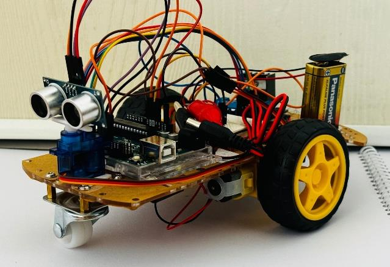
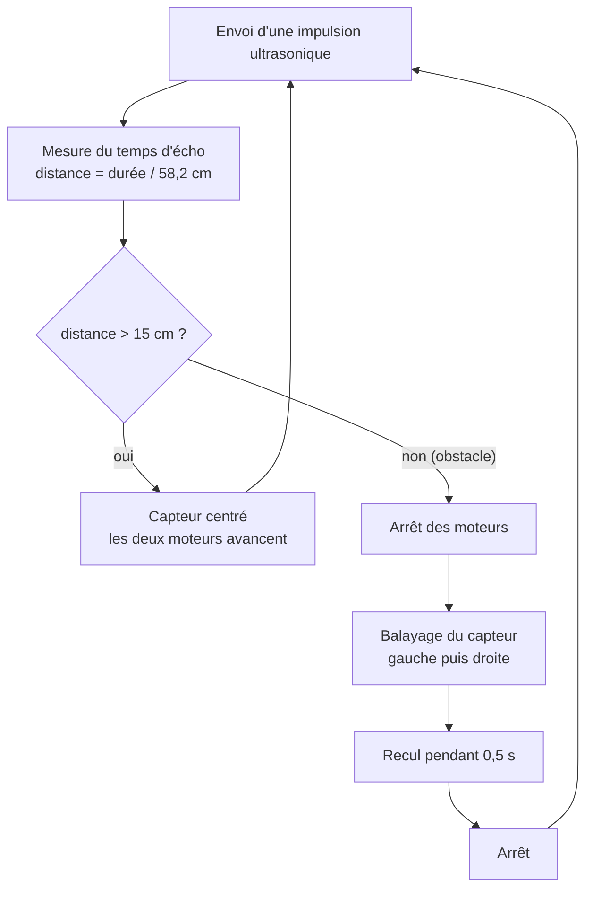

# Robot éviteur d'obstacles — Arduino Uno

> Robot mobile autonome qui avance, détecte les obstacles avec un capteur ultrasonique HC-SR04 et réagit pour éviter la collision. Il est piloté par un **Arduino Uno** et un pont en H **L298N**.

Projet de fin de session réalisé en binôme avec **Soma Marion Laurence Malika**.
Cours **INF1643 — Architecture des ordinateurs II** · Université du Québec en Outaouais · Hiver 2024

  

https://github.com/user-attachments/assets/f3e9f7d5-014d-447b-b10c-75c17ce2acb4

🎬 **[Voir la vidéo du prototype en fonctionnement](Prototype%20fonctionnel%20du%20projet.mp4)**

---

## Matériel

| Composant | Rôle |
|---|---|
| Arduino Uno | Contrôleur principal |
| Capteur ultrasonique HC-SR04 | Mesure de la distance à l'obstacle |
| Servomoteur | Oriente le capteur pour balayer gauche / droite |
| Driver de moteur L298N (pont en H) | Commande des deux moteurs |
| 2 moteurs CC avec réducteur | Propulsion |
| Châssis 3 roues (2 motrices + roue folle) | Structure du robot |
| 2 piles 9 V | Alimentation de l'Arduino et des moteurs |

## Schéma de câblage

| Arduino | Branché sur |
|---|---|
| D11 | HC-SR04 — Trig |
| D12 | HC-SR04 — Echo |
| D13 | Servomoteur — signal |
| D9 (PWM) | L298N — ENA (moteur A) |
| D8, D7 | L298N — IN1, IN2 |
| D3 (PWM) | L298N — ENB (moteur B) |
| D5, D6 | L298N — IN3, IN4 |

## Fonctionnement

- La distance est calculée à partir de la durée de l'écho : `durée / 58,2` donne des centimètres.
- Tant que la voie est libre (plus de 15 cm), le robot avance avec un PWM de 200 sur 255.
- Quand un obstacle est détecté à moins de 15 cm, le robot s'arrête, le servomoteur fait balayer le capteur, puis le robot recule avant de reprendre sa mesure.
- La distance mesurée est affichée sur le moniteur série (9600 bauds).

## Pistes d'amélioration

- Utiliser les mesures du balayage gauche / droite pour **choisir le côté le plus dégagé** et tourner dans cette direction, au lieu de seulement reculer.
- Initialiser la liaison série une seule fois dans `setup()`, plutôt qu'à chaque passage dans `loop()`.
- Traiter le cas d'une distance exactement égale à 15 cm, qui ne déclenche actuellement aucune action.
- Remplacer les `delay()` par une temporisation non bloquante avec `millis()`, pour que le robot continue de mesurer pendant ses manœuvres.

## Contenu du dépôt

| Fichier | Description |
|---|---|
| [`robot_eviteur_obstacles.ino`](robot_eviteur_obstacles.ino) | Code Arduino du robot |
| [`Rapport_INF1643_Robot_Eviteur.pdf`](Rapport_INF1643_Robot_Eviteur.pdf) | Rapport de projet (analyse fonctionnelle, composants, montage, diagramme de flux) |
| `Présentation Projet de fin de session- Architecture II.pptx` | Présentation orale du projet |
| `Prototype fonctionnel du projet.mp4` | Vidéo du robot en fonctionnement |
| `Capture d'écran 2024-04-20 095326.png` | Schéma de câblage |
| [`images/robot.jpg`](images/robot.jpg) | Photo du robot assemblé |

## Utilisation

1. Installer l'[IDE Arduino](https://www.arduino.cc/en/software). La bibliothèque `Servo` utilisée est fournie avec l'IDE.
2. Ouvrir `robot_eviteur_obstacles.ino`. L'IDE propose de le placer dans un dossier du même nom : accepter.
3. Sélectionner la carte **Arduino Uno** et téléverser.
4. Câbler les composants selon le schéma ci-dessus et alimenter le robot.

## Licence

Ce projet est distribué sous licence MIT. Voir le fichier [LICENSE](LICENSE).
